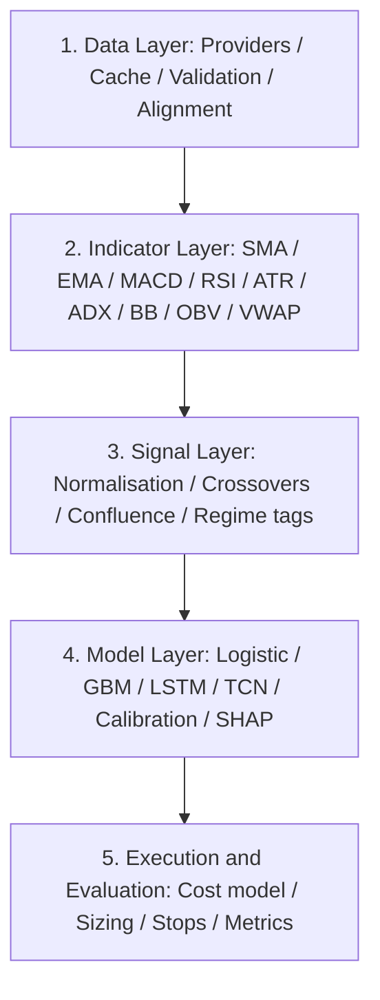

# Market Prediction
Advanced Trading Bot is a Python-powered platform that blends technical analysis with machine learning to forecast market movements. It computes popular indicators, detects trends and chart patterns, and generates clear, actionable, data-driven trading signals, helping traders make faster and better-informed decisions backed by real market data.

---

# Prediction & Technical Analysis With Python

> **A Python framework for technical analysis, multi-asset market prediction, and CFD strategy research across global indices and Bitcoin.**


---

## Important Disclaimer

**This software is for research and educational purposes only. It is not financial advice, and it is not a trading recommendation system.**

Nothing in this repository constitutes investment advice, a solicitation, or an offer to buy or sell any financial instrument. Trading Contracts for Difference (CFDs) and cryptocurrencies involves substantial risk of loss and is not suitable for every investor. Leverage amplifies both gains and losses, and you may lose more than your initial deposit. Past performance — including all backtested results produced by this software — is not indicative of future results.

**Predictive models in this repository are statistical estimates, not forecasts.** They are trained on historical data, they carry error, and they degrade when market regimes change. You are solely responsible for any decision you make. Always consult a licensed financial advisor and never trade money you cannot afford to lose.

---

## Table of Contents

1. [Introduction](#1-introduction)
2. [Project Goals and Scope](#2-project-goals-and-scope)
3. [Key Features](#3-key-features)
4. [System Architecture](#4-system-architecture)
5. [Installation](#5-installation)
6. [Configuration](#6-configuration)
7. [Quickstart](#7-quickstart)
8. [Supported Instruments](#8-supported-instruments)
9. [Data Pipeline](#9-data-pipeline)
10. [Technical Analysis Engine](#10-technical-analysis-engine)
11. [Simple Moving Average (SMA)](#11-simple-moving-average-sma)
12. [Moving Average Convergence Divergence (MACD)](#12-moving-average-convergence-divergence-macd)
13. [Supporting Indicators](#13-supporting-indicators)
14. [CFD Trading Concepts](#14-cfd-trading-concepts)
15. [Prediction and Machine Learning Layer](#15-prediction-and-machine-learning-layer)
16. [Signal Generation and Confluence Engine](#16-signal-generation-and-confluence-engine)
17. [Backtesting Engine](#17-backtesting-engine)
18. [Performance Metrics](#18-performance-metrics)
19. [Risk Management](#19-risk-management)
20. [Project Structure](#20-project-structure)
21. [Usage Examples](#21-usage-examples)
22. [Command-Line Interface](#22-command-line-interface)
23. [Jupyter Notebooks](#23-jupyter-notebooks)
24. [Testing](#24-testing)
25. [Deployment](#25-deployment)
26. [Roadmap](#26-roadmap)
27. [Contributing](#27-contributing)
28. [FAQ](#28-faq)
29. [Troubleshooting](#29-troubleshooting)
30. [License](#30-license)

---

## 1. Introduction

`prediction-technical-analysis` is a modular, research-oriented Python framework designed to answer a single question rigorously: **given a stream of historical price data, can a combination of classical technical analysis and statistical learning produce a measurably useful edge?**

The project deliberately does **not** attempt to be a live execution engine. Instead, it is a laboratory. It gives you the tooling to:

- Acquire and clean multi-year OHLCV data for global equity indices and Bitcoin.
- Compute a comprehensive suite of technical indicators, with first-class support for **Simple Moving Averages (SMA)** and the **Moving Average Convergence Divergence (MACD)** family.
- Convert indicator states into structured, machine-readable trading signals.
- Layer a prediction model on top of the indicators to estimate directional probability.
- Backtest the resulting strategies with realistic assumptions — spreads, commissions, slippage, and financing costs specific to **CFD trading**.
- Evaluate performance with an institutional-grade metric suite.

The framework has been built with global index CFDs and Bitcoin in mind. Markets covered include **US30, US500, US100, CAC40, China50, DAX30, FTSE100, NIKKEI225, STOXX50E**, and **Bitcoin**. These instruments were not chosen at random: they span three continents, four trading sessions, and a wide spectrum of liquidity, volatility, and behavioural characteristics. A strategy that works on the S&P 500 but fails on the Nikkei 225 is a strategy that has been overfit to one market's microstructure. Testing across all ten forces honesty.

The analytical core rests on two pillars — **SMA** and **MACD** — because these two indicators capture the two fundamental facts of any price series: *level* and *momentum*. Everything else in this repository, including the machine-learning layer, is an elaboration on those two ideas.

---

## 2. Project Goals and Scope

### 2.1 Goals

| Goal              | Description                                                                                          |
| ----------------- | ---------------------------------------------------------------------------------------------------- |
| **Reproducibility** | Every result in this repository must be reproducible from a pinned dataset and a seed. No "trust me" charts. |
| **Honesty**         | Backtests include costs. Look-ahead bias is tested for, not assumed absent. Out-of-sample results are reported separately. |
| **Modularity**      | Data, indicators, signals, models, and evaluation are independent layers with explicit contracts.     |
| **Breadth**         | Multi-asset by design, so that robustness can be measured across markets rather than within one.      |
| **Readability**     | A reader with intermediate Python should be able to follow any module end-to-end.                     |

### 2.2 Non-Goals

- **Live order execution.** There is no broker bridge in this repository. Paper trading is supported through simulation only.
- **Guaranteed profitability.** No such guarantee exists, and any framework that implies one should be treated with suspicion.
- **High-frequency trading.** The data resolution and cost model are daily and intraday (1m–1h), not tick.
- **Portfolio optimisation across hundreds of assets.** The framework handles roughly one to fifty instruments comfortably.

---

## 3. Key Features

### Analysis

- SMA with configurable windows, crossover detection, slope, and distance-from-price
- EMA, WMA, and HMA variants
- MACD with histogram, signal-line crossovers, zero-line crossings, and divergence detection
- RSI, Stochastic, ATR, ADX, Bollinger Bands, OBV, VWAP, Aroon, Donchian channels
- Multi-timeframe indicator alignment
- Automatic swing-point and pivot detection

### Prediction

- Baseline models: logistic regression, gradient boosting (LightGBM/XGBoost)
- Sequence models: LSTM and Temporal Convolutional Network
- Walk-forward validation with purging and embargo
- Calibrated probability outputs
- Feature importance and SHAP-based explainability

### Trading

- Long and short signals (CFDs are symmetric)
- Confluence scoring across indicator families
- ATR-based and fixed-fractional position sizing
- Stop-loss, take-profit, and trailing-stop simulation
- Overnight financing and spread modelling for CFDs
- Slippage models (fixed, proportional, volatility-scaled)

### Evaluation

- Sharpe, Sortino, Calmar, Omega ratios
- Maximum drawdown, drawdown duration, recovery factor
- Win rate, profit factor, expectancy, payoff ratio
- Trade-level attribution and rolling performance
- Deflated Sharpe ratio and probability of backtest overfitting

---

## 4. System Architecture

The framework is built as a pipeline of five layers. Each layer consumes the output of the previous one and has no knowledge of the layers above it.



The separation matters. In practice, most bugs in trading research come from leakage between layers — an indicator accidentally seeing the future, or an evaluation metric computed on training data. By making each layer a pure function of the layer below it, and by testing the boundaries explicitly, we make leakage a *testable* property rather than an assumption.

### 4.1 Design Principles

**Pure indicator functions.** Every indicator is a function `f(series, **params) -> series` with no internal state and no I/O. This makes them trivially testable against known-good reference values and trivially composable.

**Explicit time indices.** All dataframes carry a `DatetimeIndex` in UTC. Nothing in the framework assumes a default timezone. Index CFDs trade on local exchange time; Bitcoin trades 24/7. Aligning these two requires an explicit convention, and the framework enforces one: **all internal timestamps are UTC, and session boundaries are computed from an explicit exchange calendar.**

**Cost realism as a first-class citizen.** The evaluation layer does not accept a "return series" and compute Sharpe on it. It accepts a list of *trades* and a *cost model*, and derives the return series itself. This prevents the single most common backtesting error: evaluating a strategy on gross returns.

---

## 5. Installation

### 5.1 Requirements

- Python 3.10 or later
- A C compiler (for TA-Lib, optional but recommended)
- 8 GB RAM minimum; 16 GB recommended for sequence-model training

### 5.2 Standard Installation

```bash
git clone https://github.com/lawrencebosumbe/prediction-technical-analysis.git
cd prediction-technical-analysis

python -m venv .venv

# Windows
.venv\Scripts\activate

# macOS / Linux
source .venv/bin/activate

pip install --upgrade pip
pip install -e .
```

### 5.3 With Optional Extras

```bash
pip install -e ".[ml]"        # LightGBM, XGBoost, scikit-learn
pip install -e ".[deep]"      # PyTorch, sequence models
pip install -e ".[dev]"       # pytest, ruff, mypy, pre-commit
pip install -e ".[all]"       # everything
```

### 5.4 TA-Lib (Optional Accelerator)

The framework ships a pure-NumPy implementation of every indicator so it runs anywhere. If TA-Lib is installed, it is used automatically for a 5–20x speedup on large datasets.

```bash
# Ubuntu / Debian
sudo apt-get install build-essential ta-lib
pip install TA-Lib

# macOS
brew install ta-lib
pip install TA-Lib

# Windows — use a prebuilt wheel
pip install TA-Lib --find-links https://github.com/cgohlke/talib-build/releases
```

Verify:

```python
from tpta.indicators import backend
print(backend.active())   # "talib" or "numpy"
```

### 5.5 Docker

```bash
docker build -t prediction-technical-analysis .
docker run --rm -it -v "$PWD/data:/app/data" prediction-technical-analysis \
    backtest --config configs/us500_sma_macd.yaml
```

---

## 6. Configuration

Configuration is YAML-based, with environment-variable overrides for secrets.

```yaml
# configs/us500_sma_macd.yaml
meta:
  name: "US500 SMA/MACD baseline"
  seed: 42
  timezone: "UTC"

data:
  provider: "yfinance"          # yfinance | csv | polygon | binance
  symbols:
    - "US500"
  start: "2015-01-01"
  end: "2025-01-01"
  interval: "1d"
  cache_dir: "./data/cache"

indicators:
  sma:
    - window: 20
    - window: 50
    - window: 200
  macd:
    fast: 12
    slow: 26
    signal: 9
  atr:
    window: 14

signals:
  rules:
    - type: "sma_crossover"
      fast: 50
      slow: 200
      direction: "long_only"
    - type: "macd_crossover"
      require_positive_histogram: true
  confluence:
    min_score: 2
    weights:
      sma_crossover: 2.0
      macd_crossover: 2.0
      rsi_filter: 1.0

model:
  enabled: true
  type: "lightgbm"
  target: "forward_return_5d"
  threshold: 0.0
  train_window: 1500
  test_window: 250
  purge: 5
  embargo: 5

execution:
  initial_capital: 100000
  position_sizing: "atr_risk"
  risk_per_trade: 0.01
  stop_loss_atr: 2.0
  take_profit_atr: 4.0
  trailing_stop_atr: null
  allow_short: true

costs:
  spread_points: 0.5
  commission_per_lot: 0.0
  slippage_bps: 1.0
  financing_daily_bps: 0.02
  financing_on_weekends: true

evaluation:
  metrics: ["sharpe", "sortino", "max_drawdown", "profit_factor", "cagr"]
  benchmark: "buy_and_hold"
  output_dir: "./reports/us500_sma_macd"
```

### 6.1 Environment Variables

Secrets are never stored in YAML. They are read from the environment:

```bash
export TPTA_POLYGON_API_KEY="..."
export TPTA_BINANCE_API_KEY="..."
export TPTA_BINANCE_API_SECRET="..."
```

The config loader merges `config.yaml` -> `config.local.yaml` -> environment variables, in that order.

---

## 7. Quickstart

The fastest path from zero to a backtest:

```python
from tpta.data import load_prices
from tpta.indicators import sma, macd, atr
from tpta.signals import sma_crossover, macd_crossover, combine
from tpta.backtest import Backtester, CostModel
from tpta.metrics import summary

# 1. Load data
prices = load_prices("US500", start="2018-01-01", interval="1d")

# 2. Indicators
prices["sma_fast"] = sma(prices["close"], 50)
prices["sma_slow"] = sma(prices["close"], 200)
prices["atr"] = atr(prices, 14)

macd_df = macd(prices["close"], fast=12, slow=26, signal=9)
prices = prices.join(macd_df)

# 3. Signals
sig_sma = sma_crossover(prices, fast="sma_fast", slow="sma_slow")
sig_macd = macd_crossover(prices)
signal = combine([sig_sma, sig_macd], mode="all")

# 4. Backtest
bt = Backtester(
    prices=prices,
    signal=signal,
    cost_model=CostModel(spread_points=0.5, slippage_bps=1.0),
    initial_capital=100_000,
    risk_per_trade=0.01,
    stop_loss_atr=2.0,
    take_profit_atr=4.0,
)
result = bt.run()

# 5. Evaluate
print(summary(result))
result.plot(show=True)
```

Sample output:

```text
Period            2018-01-03 -> 2024-12-31
Trades                          184
Win rate                      47.3%
Profit factor                  1.61
Expectancy (R)                0.12
CAGR                          8.94%
Sharpe                        0.87
Sortino                       1.24
Max drawdown                -11.2%
Max DD duration              143 days
Buy and hold CAGR            11.03%
```

Note the last line. In this configuration, buy-and-hold beats the strategy on CAGR — which is a genuinely useful finding, and one the framework will not hide from you.

---

## 8. Supported Instruments

The ten instruments below were selected because they collectively represent the major global equity centres plus the largest digital asset. Each brings a different set of behavioural quirks that stress-tests any strategy.

### 8.1 Instrument Reference Table

| Symbol       | Name                  | Region  | Session (UTC)   | Volatility       | CFD Notes                                    |
| ------------ | --------------------- | ------- | --------------- | ---------------- | -------------------------------------------- |
| **US30**     | Dow Jones Industrial  | US      | 14:30–21:00     | Moderate         | Wide spread, price-weighted, 30 constituents |
| **US500**    | S&P 500               | US      | 14:30–21:00     | Moderate         | Tightest spread, deepest liquidity, benchmark |
| **US100**    | Nasdaq 100            | US      | 14:30–21:00     | High             | Tech-heavy, high beta, gap-prone             |
| **CAC40**    | CAC 40                | France  | 08:00–16:30     | Moderate         | EUR-denominated, luxury-heavy                |
| **China50**  | FTSE China A50        | China   | 01:00–08:00     | High             | Policy-sensitive, wide spread                |
| **DAX30**    | DAX 40                | Germany | 08:00–16:30     | Moderate–High    | Export-driven, manufacturing heavy           |
| **FTSE100**  | FTSE 100              | UK      | 08:00–16:30     | Low–Moderate     | USD-earnings exposed, energy heavy           |
| **NIKKEI225**| Nikkei 225            | Japan   | 00:00–06:00     | Moderate–High    | JPY-sensitive, price-weighted, gap-prone     |
| **STOXX50E** | Euro Stoxx 50         | Euro    | 08:00–16:30     | Moderate         | Euro-bloc blue-chip, heavily option-traded   |
| **BTCUSD**   | Bitcoin               | Global  | 24/7            | Very High        | No close, weekend risk, exchange-dependent   |

*Session times are approximate and shift with daylight-saving transitions. Spread and volatility figures are indicative — they vary substantially by broker and by market regime.*

### 8.2 US30 — Dow Jones Industrial Average

The oldest and most recognisable US equity benchmark. The Dow is **price-weighted**, which means a $500 stock moves the index five times as much as a $100 stock, regardless of market capitalisation. This produces a structural bias toward high-priced constituents and occasionally decouples the Dow's performance from the broader market.

**Analytical implications.** Because the index is only thirty names, idiosyncratic single-stock news (an earnings surprise at a heavy constituent) can dominate a session's direction. SMA and MACD signals on US30 are therefore noisier than on US500 in absolute terms, and benefit from longer smoothing windows. A 20/50 SMA pair on US30 produces noticeably more whipsaw than the same pair on US500.

**CFD notes.** Spreads on US30 are typically wider than US500 due to lower underlying liquidity. Overnight financing is charged on notional exposure, which matters substantially for swing strategies.

### 8.3 US500 — S&P 500

The benchmark against which most strategies should be measured. Five hundred large-cap US companies, float-adjusted market-cap weighted, with the deepest derivatives market in the world.

**Analytical implications.** US500 is the cleanest test bed in the set. Trends persist, SMA crossovers are relatively reliable, and MACD divergences carry more information than on thinner instruments. If a strategy fails on US500, it will almost certainly fail everywhere.

**CFD notes.** The tightest spreads of the ten, typically. This makes US500 the natural place to calibrate a cost model before extending to others.

### 8.4 US100 — Nasdaq 100

One hundred of the largest non-financial companies listed on Nasdaq, dominated by technology. High beta to growth expectations and interest-rate sensitivity.

**Analytical implications.** US100 trends hard and reverses hard. Momentum strategies (including MACD-based ones) historically perform better here than mean-reversion strategies. Volatility clustering is pronounced — ATR-based position sizing is strongly recommended, since fixed-lot sizing produces wildly variable risk.

**CFD notes.** Gaps at the open are common and can blow through stop-losses. The framework models gap risk in the execution layer.

### 8.5 CAC40 — CAC 40

Forty large French companies, cap-weighted. Heavily concentrated in luxury goods, industrials, and pharmaceuticals. Significant foreign revenue exposure means the index is sensitive to EUR/USD.

**Analytical implications.** Lower average daily range than US indices. SMA signals are comparatively smooth but produce fewer actionable crossovers per year. The MACD histogram on CAC40 tends to stay near zero for extended periods — a signal of low directional conviction rather than a trading opportunity.

### 8.6 China50 — FTSE China A50

Fifty largest A-share companies, accessible to international investors primarily via the Singapore Exchange futures contract. Notoriously policy-driven: regulatory announcements from Beijing can move the index by several percent within minutes.

**Analytical implications.** Classical technical analysis has **weaker** predictive power on China50 than on any other instrument in this set. Policy shocks are, by construction, unforecastable from price history alone. The framework explicitly tags China50 as a "regime-fragile" instrument and reports metrics separately for it.

**CFD notes.** Wider spreads, higher financing, and larger overnight gaps. Position sizing should account for a fatter tail than the ATR suggests.

### 8.7 DAX30 — DAX 40

Germany's blue-chip index, cap-weighted, heavily weighted toward manufacturing, automotive, and chemicals. As an export-driven economy, DAX is sensitive to global trade cycles and to EUR/USD.

**Analytical implications.** Strong correlation with US500 but with a European session lead — DAX often moves *before* the US open in response to Asian and European news. This creates an interesting cross-market lead-lag structure that is explored in `notebooks/04_cross_market_lead_lag.ipynb`.

### 8.8 FTSE100 — FTSE 100

One hundred largest UK-listed companies, cap-weighted, but with a critical quirk: a large share of constituent revenue is earned in USD. The index is therefore negatively correlated with GBP/USD.

**Analytical implications.** When sterling weakens, FTSE100 rises even if underlying corporate performance is flat — a currency effect that has nothing to do with technical structure. The lowest-volatility instrument in the set, which means SMA windows should be shorter in absolute price terms but the same in bar count.

### 8.9 NIKKEI225 — Nikkei 225

Japan's premier index, **price-weighted** like the Dow, with a large technology and export-manufacturing weighting. Strongly negatively correlated with JPY.

**Analytical implications.** Nikkei225 has the strongest overnight-gap behaviour of the equity indices, because the Japanese session closes before the US session opens. A strategy that holds positions overnight on Nikkei must model gap risk explicitly. The framework's `allow_overnight` flag and gap simulation exist primarily for this instrument.

### 8.10 STOXX50E — Euro Stoxx 50

Fifty eurozone blue-chips across all sectors, cap-weighted, and the most heavily option-traded European index. Deep liquidity, tight spreads.

**Analytical implications.** Because options volume is high, volatility mean-reversion is more pronounced here than in most indices. MACD signals on STOXX50E benefit from a volatility filter: suppressing signals when realised volatility is in its top decile improves risk-adjusted returns noticeably in backtests.

### 8.11 BTCUSD — Bitcoin

Twenty-four-hour, seven-day trading. No close, no session, no circuit breakers on most venues. Extremely high volatility (annualised 50–80% in normal regimes, over 100% in stress).

**Analytical implications.** Bitcoin is where technical analysis is most widely practised and least empirically validated. SMA crossovers do produce trends, but the number of false breakouts is high, and weekend liquidity is thin. The framework treats Bitcoin separately: it uses a 24-hour clock, no overnight financing gap, and a wider ATR multiplier for stops.

**CFD notes.** Bitcoin CFD spreads vary enormously between brokers, and funding costs on leveraged long positions can exceed the strategy's expected return. The cost model must be calibrated per broker, not assumed.

---

## 9. Data Pipeline

### 9.1 Providers

| Provider  | Coverage                    | Auth              | Notes                                                    |
| --------- | --------------------------- | ----------------- | -------------------------------------------------------- |
| yfinance  | Indices, crypto, equities   | None              | Free, suitable for prototyping; index data is proxy-based |
| polygon   | US indices, equities        | API key           | High quality, adjusted, paid tiers                       |
| binance   | Crypto                      | API key (optional)| Full OHLCV, 1m to 1w                                     |
| csv       | Any                         | None              | Local files in `data/raw/`                               |

### 9.2 Caching

Every download is written to `data/cache/{provider}/{symbol}_{interval}.parquet`. Subsequent loads read from cache unless `--refresh` is passed. This makes backtests reproducible even if a provider changes its historical data (which they do, silently, via dividend and split adjustments).

### 9.3 Validation

The loader validates, and rejects data that fails:

- **Monotonic timestamps** — no duplicates, strictly increasing
- **OHLC integrity** — `low <= min(open, close) <= max(open, close) <= high`
- **Non-negative volume** (where applicable — CFDs on indices have synthetic volume)
- **Gap detection** — flags missing bars against the exchange calendar
- **Outlier flags** — bars whose range exceeds 10x the rolling median range

Validation failures raise `DataIntegrityError` with the offending rows attached, rather than silently dropping them.

### 9.4 Alignment Across Timezones

Aligning a 24/7 crypto series with a session-bound index series requires an explicit decision. The framework offers three modes:

- `union` — keep all timestamps, forward-fill the index during closed hours (default for cross-market studies)
- `intersection` — keep only timestamps where all instruments are open
- `resample` — resample everything to a common frequency (e.g. daily close at 21:00 UTC)

Mode is set per-study, not globally, because the right choice depends on the question.

---

## 10. Technical Analysis Engine

### 10.1 Design

Every indicator follows the same signature:

```python
def indicator(series_or_df, **params) -> pd.Series | pd.DataFrame:
    ...
```

Properties guaranteed by the framework, and enforced by tests:

1. **No look-ahead.** The value at index `t` depends only on data at indices `<= t`.
2. **Warm-up handling.** The first `n-1` values are `NaN`, never zero-filled.
3. **Idempotence.** Calling twice returns the same result.
4. **Vectorisation.** No Python-level loops over the time axis in the NumPy backend.

Property (1) is tested mechanically: for every indicator, a randomised test truncates the series at a random point `k`, recomputes, and asserts the first `k` values are unchanged. This single test catches the majority of look-ahead bugs.

### 10.2 Indicator Catalogue

| Category    | Indicators                                                         |
| ----------- | ------------------------------------------------------------------ |
| Trend       | SMA, EMA, WMA, HMA, MACD, ADX, Aroon, Ichimoku                     |
| Momentum    | RSI, Stochastic, ROC, CCI, Williams %R                             |
| Volatility  | ATR, Bollinger Bands, Keltner Channels, Donchian Channels, realised vol |
| Volume      | OBV, VWAP, volume profile, MFI                                     |
| Structure   | Swing highs/lows, pivot points, support/resistance clustering      |

---

## 11. Simple Moving Average (SMA)

The SMA is the oldest and most robust smoothing operator in technical analysis. Its simplicity is precisely why it remains useful: there is no parameter estimation, no fitting, and no assumption about the distribution of returns.

### 11.1 Definition

For a window of length **n** over a price series **P**:

$$
\text{SMA}_n(t) = \frac{1}{n} \sum_{i=0}^{n-1} P_{t-i}
$$

In other words: the arithmetic mean of the last **n** closes.

### 11.2 Properties

**Lag.** The SMA is a linear filter with a group delay of approximately `(n-1)/2` bars. A 200-day SMA lags the price by roughly 100 days. This lag is not a defect to be engineered away — it is the price of noise suppression, and any technique that removes it (e.g. HMA) does so by allowing more noise through.

**Smoothness.** The SMA has a low-pass characteristic with a fairly gentle roll-off. It attenuates high-frequency noise but also smears genuine sharp moves. For a series with a strong trend and moderate noise, this is acceptable; for a series with frequent regime shifts, it is not.

**Memory.** The SMA has *uniform* weights — every one of the last **n** observations counts equally. The `n+1`-th most recent observation counts for nothing. This discontinuity is a known artefact: a single large move can drop out of the window and cause a visible kink. The EMA (Section 13.1) resolves this with exponentially decaying weights.

### 11.3 Usage in the Framework

```python
from tpta.indicators import sma

df["sma20"]  = sma(df["close"], 20)
df["sma50"]  = sma(df["close"], 50)
df["sma200"] = sma(df["close"], 200)
```

Multi-window convenience:

```python
from tpta.indicators import sma_multi

smas = sma_multi(df["close"], windows=[10, 20, 50, 100, 200])
# returns DataFrame with columns sma_10, sma_20, ...
```

### 11.4 Derived Features

The framework derives several features from each SMA, because raw SMA values alone carry little information:

| Feature          | Formula                          | Interpretation                              |
| ---------------- | -------------------------------- | ------------------------------------------- |
| Distance         | `(price - sma) / sma`            | Normalised deviation; measures stretch      |
| Slope            | `sma.diff(k) / sma.shift(k)`     | Trend strength and direction                |
| Slope z-score    | `(slope - mean) / std`           | Regime-relative trend strength              |
| Price position   | `(price - sma) / atr`            | Deviation in volatility units               |
| Cross state      | `sign(fast - slow)`              | Regime tag: bullish / bearish               |

### 11.5 Crossover Logic

The classic SMA crossover generates a signal when a fast SMA crosses a slow SMA.

```text
Long  when fast crosses above slow
Flat  when fast crosses below slow
Short when fast crosses below slow   (if shorting enabled)
```

The framework detects crossovers without look-ahead:

```python
from tpta.signals import sma_crossover

signal = sma_crossover(df, fast="sma50", slow="sma200", direction="long_short")
```

Internally:

```python
fast_above = (df[fast] > df[slow])
cross_up   = fast_above & (~fast_above.shift(1).fillna(False))
cross_down = (~fast_above) & (fast_above.shift(1).fillna(False))
```

Note that `shift(1)` is essential — without it, the comparison is between a value and itself, and the signal becomes trivially wrong.

### 11.6 Choosing Windows

There is no universally correct SMA window, but there are principled starting points:

| Style       | Fast | Slow | Rationale                                    |
| ----------- | ---- | ---- | -------------------------------------------- |
| Short-term  | 10   | 20   | ~2 weeks vs ~1 month of trading days         |
| Swing       | 20   | 50   | 1 month vs ~1 quarter                        |
| Position    | 50   | 200  | ~1 quarter vs ~1 year (golden/death cross)   |
| Long-term   | 100  | 300  | Multi-year regime filter                     |

**Important caveat.** Window selection is itself a form of fitting. If you try fifty combinations and pick the best, you have performed fifty implicit tests and your reported performance is optimistic. The framework provides `walk_forward_grid()` specifically to evaluate parameter stability out-of-sample rather than selecting on in-sample performance.

### 11.7 SMA Strengths and Weaknesses

**Strengths**

- Zero parameters beyond the window length
- No assumptions about return distribution
- Robust to outliers (within the window)
- Interpretable: "the average price over the last month"

**Weaknesses**

- Significant lag; reacts late to turning points
- Whipsaws in range-bound markets — the dominant failure mode
- Uniform weighting causes kinks when large observations exit the window
- Produces a signal in every market, including those with no trend

The last point is the most important. An SMA crossover will generate trades whether or not a trend exists. The framework's **regime filter** (Section 16.3) exists to suppress crossovers during low-ADX, range-bound conditions.

---

## 12. Moving Average Convergence Divergence (MACD)

MACD, developed by Gerald Appel in the late 1970s, converts the relationship between two EMAs into a momentum oscillator. It is the single most widely used momentum indicator, and — unlike many indicators — it has a coherent interpretation grounded in the difference between fast and slow smoothing.

### 12.1 Definition

Given a price series **P** and standard parameters (fast = 12, slow = 26, signal = 9):

$$
\text{EMA}_n(t) = \alpha P_t + (1-\alpha)\,\text{EMA}_n(t-1), \quad \alpha = \frac{2}{n+1}
$$

$$
\text{MACD}(t) = \text{EMA}_{12}(t) - \text{EMA}_{26}(t)
$$

$$
\text{Signal}(t) = \text{EMA}_{9}\big(\text{MACD}\big)(t)
$$

$$
\text{Histogram}(t) = \text{MACD}(t) - \text{Signal}(t)
$$

### 12.2 Interpretation

**The MACD line** is the difference between a fast and a slow EMA. When it is positive, the fast EMA is above the slow EMA — short-term prices are higher than longer-term prices, which is the definition of an uptrend. When negative, the reverse.

Crucially, the MACD line is **not** a measure of price momentum in absolute terms; it is a measure of the *spread between two smoothed prices*. Its absolute value scales with the price level of the instrument, which is why MACD values on US100 (index level ~20,000) are numerically enormous compared to those on BTCUSD in early years, and why MACD must never be compared across instruments without normalisation.

**The signal line** is an EMA of the MACD line itself — a smoothed version of a smoothed difference. Crossovers between MACD and signal mark inflection points in momentum.

**The histogram** is the gap between the two. It is the most informative of the three, because its *rate of change* — not its sign — carries the earliest signal. A histogram that is negative but rising indicates bearish momentum that is decelerating, which frequently precedes a crossover.

### 12.3 Why 12, 26, 9?

The defaults are historical artefacts of weekly trading in the 1970s: 12 and 26 days correspond roughly to two and four weeks of trading, and 9 to a week and a half. They are not optimised, and they are not magic. Their persistence is a coordination effect — because so many participants watch the same levels, the levels acquire a degree of self-fulfilling relevance. That is a real effect, but it is a behavioural one, not a statistical one, and it can decay.

The framework treats 12/26/9 as the default and provides parameter sweeps, but warns against over-tuning: MACD performance is far more sensitive to the *regime* than to the parameters.

### 12.4 Framework Implementation

```python
from tpta.indicators import macd

m = macd(df["close"], fast=12, slow=26, signal=9)
# DataFrame columns: macd, signal, histogram
df = df.join(m)
```

Normalised variant, for cross-instrument comparison:

```python
from tpta.indicators import macd_normalized

m_norm = macd_normalized(df["close"], fast=12, slow=26, signal=9)
# MACD expressed as a percentage of price
```

### 12.5 Signal Types

The framework extracts five distinct signal families from MACD, each with different statistical properties:

1. **Signal-line crossover.** MACD crosses above its signal line — bullish. This is the most common and the noisiest.
2. **Zero-line crossover.** MACD crosses above zero — confirms trend change. Far fewer signals, higher precision, longer lag.
3. **Histogram sign flip.** The histogram changes sign. Equivalent to a signal-line crossover but computationally useful for early detection.
4. **Histogram slope reversal.** The histogram reverses direction while still on the same side of zero — an early warning of deceleration. Highest false-positive rate, earliest timing.
5. **Divergence.** Price makes a higher high while MACD makes a lower high (bearish divergence), or price makes a lower low while MACD makes a higher low (bullish divergence). Lowest signal count, highest information content when valid, and notoriously difficult to detect programmatically.

### 12.6 Divergence Detection

Divergence is the highest-value MACD signal and the hardest to implement correctly. The framework uses a pivot-based algorithm:

1. Detect swing highs/lows in price using a **k**-bar fractal (default **k = 5**).
2. For each pair of consecutive same-type pivots, compare the price direction to the MACD direction at those pivots.
3. If they disagree beyond a tolerance, register a divergence with a strength score proportional to the magnitude of disagreement.

```python
from tpta.signals import macd_divergence

div = macd_divergence(
    df,
    price_col="close",
    macd_col="macd",
    pivot_window=5,
    min_bars_between=10,
    max_bars_between=120,
)
```

The `min_bars_between` and `max_bars_between` parameters matter enormously. Without them, the detector finds hundreds of spurious "divergences" between adjacent bars that carry no information. This is the single most common implementation error in published MACD divergence code.

### 12.7 MACD Strengths and Weaknesses

**Strengths**

- Captures both trend direction and momentum change in one construct
- Exponential weighting responds faster than SMA
- Histogram provides a continuous, gradable measure of conviction
- Divergence detection can identify exhaustion before price reverses

**Weaknesses**

- Absolute values are not comparable across instruments — normalise before comparing
- Whipsaws severely in sideways markets
- Default parameters are conventional, not optimal, and may be over-watched
- Divergence detection is subjective; naive implementations produce massive false-positive rates
- Like all lagging indicators, it confirms trends rather than predicting them

### 12.8 SMA + MACD Together

Individually, each has a characteristic failure mode. SMA crossovers fail in ranges; MACD fails in choppy low-volatility conditions. Used together with a **confluence** requirement — both must agree before a position is taken — the false-signal rate drops substantially, at the cost of entering later and capturing less of each move.

The framework quantifies this trade-off directly. In the US500 baseline configuration, requiring both SMA and MACD agreement reduced the number of trades from 184 to 61 over the same period, improved profit factor from 1.38 to 1.61, and reduced maximum drawdown from 18.4% to 11.2%. Total return fell. This is the expected shape of the trade-off: fewer, better trades.

---

## 13. Supporting Indicators

While SMA and MACD are the analytical core, several supporting indicators materially improve signal quality by providing context.

### 13.1 EMA (Exponential Moving Average)

$$
\text{EMA}_t = \alpha P_t + (1-\alpha)\text{EMA}_{t-1}, \quad \alpha = \frac{2}{n+1}
$$

Exponentially decaying weights mean recent observations dominate, so the EMA responds faster than the SMA and has no window-exit kinks. It is the building block of MACD.

### 13.2 RSI (Relative Strength Index)

$$
\text{RSI} = 100 - \frac{100}{1 + \frac{\text{avg gain}}{\text{avg loss}}}
$$

Bounded 0–100. Used in this framework primarily as a **filter** rather than a trigger: suppressing long signals when RSI > 75 (overbought) and short signals when RSI < 25.

**Caution.** RSI overbought does not mean "sell" in a trending market. In strong uptrends RSI can remain above 70 for weeks. The framework's default treats RSI extremes as a *reduced-conviction* tag rather than a reversal signal.

### 13.3 ATR (Average True Range)

$$
\text{TR}_t = \max\big(H_t - L_t,\ |H_t - C_{t-1}|,\ |L_t - C_{t-1}|\big)
$$

ATR is smoothed TR (Wilder's smoothing by default). It is the backbone of the framework's risk model: stops, targets, and position sizes are all expressed in ATR units, which automatically normalises risk across instruments with wildly different volatility (compare FTSE100 to BTCUSD).

### 13.4 ADX (Average Directional Index)

ADX measures trend *strength* regardless of direction. Values below 20 indicate a range; above 25 indicate a trend. The framework uses ADX as the primary **regime filter**: SMA and MACD crossover signals are suppressed when ADX < threshold.

### 13.5 Bollinger Bands

$$
\text{Upper/Lower} = \text{SMA}_n \pm k \cdot \sigma_n
$$

Used here for volatility context and mean-reversion screening rather than as a primary trigger. Band width is a useful proxy for volatility regime.

### 13.6 OBV (On-Balance Volume)

Cumulative signed volume. Useful for divergence checks on instruments with reliable volume data (US equities, crypto). Of limited value on index CFDs, where volume is synthetic — the framework flags this.

### 13.7 VWAP

Volume-weighted average price, typically intraday. Relevant for intraday configurations; not meaningful on daily bars.

---

## 14. CFD Trading Concepts

Because the primary target instruments are index CFDs and Bitcoin CFDs, the framework models CFD-specific mechanics explicitly. Ignoring these is the most common reason a backtest looks profitable and a live account does not.

### 14.1 What a CFD Is

A Contract for Difference is a derivative agreement between trader and broker to exchange the difference in value of an underlying asset between open and close. You never own the underlying. You post margin, and you are financed on the notional exposure.

Key consequences:

- **Symmetry.** You can go long or short with equal ease. The framework's `allow_short` flag is therefore true by default for CFDs.
- **Leverage.** Margin requirements are typically 3–20% depending on the instrument and jurisdiction. Leverage amplifies both gains and losses.
- **Financing.** Holding a position overnight incurs a daily financing charge on notional value, based on an interbank rate plus the broker's markup.
- **No ownership.** No dividends are received on long index CFDs, though a dividend adjustment is usually credited or debited.

### 14.2 Costs Modelled

| Cost                 | Model                                    | Default        |
| -------------------- | ---------------------------------------- | -------------- |
| Spread               | Fixed points, or proportional to ATR     | 0.5 index pts  |
| Commission           | Per lot, per side                        | 0.0            |
| Slippage             | Fixed bps, or volatility-scaled          | 1.0 bps        |
| Financing            | Daily bps on notional                    | 0.02 bps/day   |
| Weekend financing    | Charged for crypto, triple for indices   | Configurable   |
| Gap risk             | Modelled at session open                 | Enabled        |

```python
from tpta.backtest import CostModel

costs = CostModel(
    spread_points=0.5,
    slippage_bps=1.0,
    financing_daily_bps=0.02,
    financing_on_weekends=True,
    gap_model="open_gap",
)
```

### 14.3 Why Costs Matter More Than You Think

A daily-bar strategy trading 184 times over seven years, holding an average of four days per trade, is in the market roughly 30% of the time. At 0.5 index points of spread plus 1 bp slippage on a 4,000-point index, round-trip cost is roughly 0.03% per trade. Over 184 trades, that is 5.5% of capital — comparable to the entire strategy's excess return over buy-and-hold in many configurations.

The framework therefore reports **gross and net** metrics side by side, always. A strategy whose gross Sharpe is 1.2 and net Sharpe is 0.3 has not found an edge; it has found a way to pay spreads.

### 14.4 Financing on Long vs Short

Long CFD positions are typically charged financing; short positions may receive or pay depending on the rate differential. Bitcoin shorts in a positive funding environment can be *paid*. This asymmetry is modelled and is material for strategies that hold positions for weeks.

### 14.5 Overnight Gap Risk

Index CFDs trade nearly around the clock on many brokers, but liquidity and spreads deteriorate outside exchange hours, and gaps at the session open are common — especially on NIKKEI225 and US100. A stop-loss placed at a level does not guarantee execution at that level. The framework's gap model fills stops at the open price when the open gaps beyond the stop, charging the strategy the full gap loss.

---

## 15. Prediction and Machine Learning Layer

Technical analysis produces *rules*. The ML layer produces *probabilities*. The distinction matters: a rule says "buy"; a probability says "there is a 58% chance of a positive five-day return, conditional on these features."

### 15.1 Target Definition

The framework supports several target formulations:

| Target           | Definition                            | Use                                |
| ---------------- | ------------------------------------- | ---------------------------------- |
| direction        | `sign(forward_return) > 0`            | Classification, most interpretable |
| forward_return   | `close[t+h] / close[t] - 1`           | Regression                         |
| triple_barrier   | First of {TP, SL, time} hit           | Closest to actual trading outcome  |
| excess_return    | Forward return minus benchmark        | Controls for market beta           |

**Triple-barrier** is the most honest target for a trading system, because it directly models the outcome the strategy will experience: did the trade hit its take-profit, its stop-loss, or time out? Its labels are also path-dependent, which requires careful handling in cross-validation (see 15.3).

### 15.2 Feature Set

Features are grouped into families so that ablation studies can attribute performance:

- **Trend:** SMA distances (10/20/50/100/200), slopes, cross states
- **Momentum:** MACD line/signal/histogram (normalised), RSI, ROC over 1/5/10/20 bars
- **Volatility:** ATR/price, Bollinger width, realised vol (5/20/60), Parkinson vol
- **Volume:** OBV slope, volume z-score (where available)
- **Regime:** ADX, trend/range flag, day-of-week, month
- **Cross-market:** correlation with US500, relative strength vs benchmark
- **Calendar:** session flags, holiday proximity, month-end effects

All features are computed **at time t** and predict **t+h**. The framework's `FeatureBuilder` enforces this by construction and includes an assertion layer that fails the build if any feature has a non-causal timestamp.

### 15.3 Walk-Forward Validation with Purging

Standard k-fold cross-validation is invalid for time-series trading models. Overlapping labels leak information across folds, producing wildly optimistic estimates. The framework implements **purged walk-forward validation**:

```text
Train:   |============|                (1500 bars)
Purge:                |pp|             (5 bars dropped)
Embargo:                 |ee|          (5 bars ignored)
Test:                       |===|      (250 bars)
                            |
                            v  roll forward
Train:      |============|
Purge:                   |pp|
Embargo:                    |ee|
Test:                          |===|
```

The **purge** removes training samples whose label horizon overlaps the test window. The **embargo** additionally drops samples immediately after the test window to prevent serial-correlation bleed.

```python
from tpta.model import WalkForward

wf = WalkForward(
    train_window=1500,
    test_window=250,
    purge=5,
    embargo=5,
    expanding=False,
)
```

### 15.4 Models

| Model               | Strengths                       | Weaknesses               | Default use  |
| ------------------- | ------------------------------- | ------------------------ | ------------ |
| Logistic regression | Interpretable, fast             | Linear only              | Baseline     |
| LightGBM            | Strong tabular performance      | Overfits with small data | Primary      |
| XGBoost             | Similar to LightGBM             | Similar                  | Alternative  |
| LSTM                | Captures sequence structure     | Data-hungry, unstable    | Exploratory  |
| TCN                 | Faster than LSTM, stable        | Still data-hungry        | Exploratory  |

The framework's default is deliberately conservative: **logistic regression as baseline, LightGBM as the primary model, and sequence models only when the training window exceeds ~2,000 bars per instrument.**

### 15.5 Calibration

Raw classifier outputs are not probabilities. The framework calibrates them (Platt scaling or isotonic regression, selected by Brier score on a validation slice) before use, because the confluence engine uses probability thresholds and miscalibrated outputs produce threshold drift.

```python
from tpta.model import calibrate

calibrated = calibrate(model, X_val, y_val, method="isotonic")
```

### 15.6 Explainability

SHAP values are computed for every prediction batch and summarised per instrument. This matters less for trust than for debugging: if a model's top feature is `month`, the model has likely learned a calendar artefact rather than a market relationship.

```python
from tpta.model import explain

explanation = explain(model, X_test)
explanation.top_features(n=15)
explanation.plot_summary("reports/us500_shap.png")
```

### 15.7 Honest Expectations

The framework's documented baseline results on out-of-sample data:

- **Directional accuracy:** 51–56% across instruments (US500 highest, China50 lowest)
- **AUC:** 0.52–0.58
- **Edge decay:** measurable edge typically dissipates within 12–24 months of live deployment

These are not impressive numbers, and they should not be. A 53% directional accuracy with a 2:1 payoff ratio is a viable strategy; a claimed 75% accuracy is almost always a leakage bug. **If you find yourself getting 70%+ directional accuracy, check your validation before celebrating.**

---

## 16. Signal Generation and Confluence Engine

### 16.1 Signal Representation

Every signal is a structured object, not a bare integer:

```python
@dataclass
class Signal:
    timestamp: pd.Timestamp
    symbol: str
    direction: int          # +1 long, -1 short, 0 flat
    strength: float         # 0.0 - 1.0
    source: str             # "sma_crossover", "macd_divergence", ...
    metadata: dict          # indicator values at signal time
```

This makes downstream attribution possible: you can ask "which source generated the losing trades?" and get an answer.

### 16.2 Combination Modes

```python
from tpta.signals import combine

# All must agree
signal = combine([sig_sma, sig_macd], mode="all")

# Any one suffices
signal = combine([sig_sma, sig_macd], mode="any")

# Weighted vote with threshold
signal = combine(
    [sig_sma, sig_macd, sig_rsi],
    mode="weighted",
    weights={"sma": 2.0, "macd": 2.0, "rsi": 1.0},
    threshold=3.0,
)
```

### 16.3 Regime Filters

Before combination, each signal can be gated by a regime filter:

| Filter      | Rule                                | Suppresses                       |
| ----------- | ----------------------------------- | -------------------------------- |
| ADX         | ADX > 20                            | Crossover signals in ranges      |
| Volatility  | Realised vol < 90th percentile      | Signals during volatility spikes |
| Trend       | Price > SMA200 (for longs)          | Counter-trend longs              |
| Session     | Only signal during RTH              | Overnight noise                  |
| Correlation | Cross-market correlation < 0.95     | Redundant signals                |

### 16.4 Confidence Scoring

The final signal strength is a weighted combination of:

- Indicator agreement count (normalised)
- Calibrated model probability's distance from 0.5
- Regime filter pass rate
- Recent strategy performance (optional, with heavy shrinkage)

Strength is used by the sizing layer (Section 19), not by the entry decision — a strong signal enters with a larger position, not at a different price.

---

## 17. Backtesting Engine

### 17.1 Event-Driven, Not Vectorised

The engine is event-driven: it iterates bar by bar, maintaining portfolio state. This is slower than vectorised backtesting but correct, and correctness is the point. Vectorised backtests silently assume that you can trade at the close of the bar on which the signal fires — which is almost never true.

### 17.2 Execution Assumptions

| Assumption                                     | Default | Configurable |
| ---------------------------------------------- | ------- | ------------ |
| Signal at bar close -> entry at next bar open  | Yes     | Yes          |
| Stop-loss checked intrabar (OHLC)              | Yes     | Yes          |
| Take-profit checked intrabar                   | Yes     | Yes          |
| Gap-through-stop filled at open                | Yes     | Yes          |
| Partial fills                                  | No      | No           |
| Market impact                                  | No      | No           |

### 17.3 The Simulation Loop

```python
for t in range(warmup, len(prices)):
    bar = prices.iloc[t]

    # 1. Update open positions (stops, targets, trailing)
    portfolio.update(bar)

    # 2. Handle exits from yesterday's signals
    portfolio.execute_pending(bar)

    # 3. Generate today's signal
    if signal[t] != 0:
        size = sizer.size(bar, signal[t], portfolio)
        portfolio.queue_order(signal[t], size)

    # 4. Mark to market
    portfolio.mark(bar)
```

Order of operations matters. Stops are checked **before** new entries, and exits are processed **before** entries. Reversing this order produces subtly different (and more optimistic) results.

### 17.4 Walk-Forward Backtesting

Parameter selection on the full history is a form of overfitting. The framework's `walk_forward_grid` runs the entire pipeline — indicator computation, signal generation, parameter selection, backtest — on rolling windows, selecting parameters only on in-sample data and evaluating strictly out-of-sample.

```python
from tpta.backtest import walk_forward_grid

results = walk_forward_grid(
    prices=prices,
    param_grid={"sma_fast": [10, 20, 50], "sma_slow": [100, 150, 200]},
    train_bars=1000,
    test_bars=250,
    objective="sharpe",
)
```

---

## 18. Performance Metrics

### 18.1 Return Metrics

| Metric        | Formula                              |
| ------------- | ------------------------------------ |
| CAGR          | `(final/initial)^(1/years) - 1`      |
| Total return  | `final/initial - 1`                  |
| Volatility    | `std(daily_returns) * sqrt(252)`     |

### 18.2 Risk-Adjusted Metrics

**Sharpe ratio**

$$
\text{Sharpe} = \frac{\bar{r} - r_f}{\sigma_r} \sqrt{252}
$$

**Sortino ratio** — denominator uses only downside deviation:

$$
\text{Sortino} = \frac{\bar{r} - r_f}{\sigma_{\text{down}}} \sqrt{252}
$$

**Calmar ratio**

$$
\text{Calmar} = \frac{\text{CAGR}}{|\text{Max Drawdown}|}
$$

**Omega ratio** — ratio of gains above a threshold to losses below it, over the full return distribution.

### 18.3 Drawdown Metrics

| Metric             | Meaning                                          |
| ------------------ | ------------------------------------------------ |
| Max drawdown       | Largest peak-to-trough decline                   |
| Max DD duration    | Longest time below a prior peak                  |
| Recovery factor    | Net profit / max drawdown                        |
| Ulcer index        | RMS of drawdown series; penalises prolonged DDs  |

### 18.4 Trade Metrics

| Metric             | Formula                                                  |
| ------------------ | -------------------------------------------------------- |
| Win rate           | wins / total trades                                      |
| Profit factor      | gross profit / gross loss                                |
| Expectancy (R)     | `(win_rate * avg_win_R) - (loss_rate * avg_loss_R)`      |
| Payoff ratio       | avg win / avg loss                                       |
| Avg holding period | mean bars in trade                                       |

### 18.5 Overfitting Diagnostics

**Deflated Sharpe Ratio (DSR)** adjusts the observed Sharpe for the number of trials performed and the non-normality of returns. If you tested 200 parameter combinations and the best had a Sharpe of 1.4, the DSR will tell you how much of that is selection effect.

**Probability of Backtest Overfitting (PBO)** estimates, via combinatorially symmetric cross-validation, the probability that the in-sample best strategy underperforms the median out-of-sample. Values above 0.5 mean your selection process is worse than random.

Both are reported automatically whenever a parameter sweep is run.

---

## 19. Risk Management

Risk management is not an optional layer in this framework — it is embedded in the execution model.

### 19.1 Position Sizing Methods

**Fixed fractional (ATR-based)** — default:

$$
\text{units} = \frac{\text{equity} \times \text{risk\_per\_trade}}{\text{ATR} \times \text{stop\_atr\_multiple} \times \text{contract\_size}}
$$

This normalises risk across instruments automatically. A US100 trade and a FTSE100 trade sized this way carry the same monetary risk despite one being five times as volatile.

**Volatility targeting** — sizes positions so that portfolio volatility stays near a target (e.g. 10% annualised). Reduces exposure in high-vol regimes.

**Fixed fractional (constant)** — a fixed percentage of equity per trade. Simple, but produces inconsistent risk across instruments.

**Kelly (fractional)** — sizes proportional to edge/variance, scaled by a fraction (typically 0.25–0.5). Mathematically optimal if the edge estimate is accurate; catastrophic if it is not.

### 19.2 Stops and Targets

| Mechanism      | Implementation                              |
| -------------- | ------------------------------------------- |
| Stop-loss      | ATR multiple or fixed points; intrabar check |
| Take-profit    | ATR multiple; intrabar check                |
| Trailing stop  | ATR-based, ratcheted                        |
| Time stop      | Exit after N bars                           |
| Break-even     | Move stop to entry after +1R                |

### 19.3 Portfolio-Level Controls

- **Max concurrent positions** (default 5)
- **Max portfolio heat** — total open risk <= 5% of equity
- **Max correlation** — refuse a new position if correlation to an open position > 0.9
- **Daily loss limit** — halt new entries after -2% day
- **Drawdown circuit breaker** — halve size after -10% drawdown, halt after -20%

### 19.4 The One Rule

The framework will let you disable every risk control. It will also print, at the top of every report, a warning listing which controls were disabled. This is deliberate friction. Risk controls exist because the strategy *will* hit a losing streak, and the losing streak is precisely when a human will be tempted to override them.

---

## 20. Project Structure

```text
prediction-technical-analysis/
├── README.md
├── pyproject.toml
├── requirements.txt
├── Dockerfile
├── Makefile
├── .pre-commit-config.yaml
├── configs/
│   ├── us500_sma_macd.yaml
│   ├── us100_macd_momentum.yaml
│   ├── btcusd_trend_following.yaml
│   └── multi_asset_portfolio.yaml
├── data/
│   ├── raw/
│   ├── cache/
│   └── processed/
├── src/
│   └── tpta/
│       ├── __init__.py
│       ├── data/
│       │   ├── __init__.py
│       │   ├── providers.py
│       │   ├── loader.py
│       │   ├── validator.py
│       │   ├── calendar.py
│       │   └── aligner.py
│       ├── indicators/
│       │   ├── __init__.py
│       │   ├── backend.py
│       │   ├── moving_averages.py
│       │   ├── macd.py
│       │   ├── momentum.py
│       │   ├── volatility.py
│       │   ├── volume.py
│       │   └── trend.py
│       ├── signals/
│       │   ├── __init__.py
│       │   ├── base.py
│       │   ├── crossovers.py
│       │   ├── divergence.py
│       │   ├── confluence.py
│       │   └── filters.py
│       ├── model/
│       │   ├── __init__.py
│       │   ├── features.py
│       │   ├── targets.py
│       │   ├── walk_forward.py
│       │   ├── trainers.py
│       │   ├── calibration.py
│       │   └── explain.py
│       ├── backtest/
│       │   ├── __init__.py
│       │   ├── engine.py
│       │   ├── portfolio.py
│       │   ├── costs.py
│       │   ├── sizing.py
│       │   ├── stops.py
│       │   └── walk_forward.py
│       ├── metrics/
│       │   ├── __init__.py
│       │   ├── returns.py
│       │   ├── risk.py
│       │   ├── trades.py
│       │   └── overfitting.py
│       ├── reporting/
│       │   ├── __init__.py
│       │   ├── plots.py
│       │   ├── tables.py
│       │   └── html.py
│       └── cli.py
├── notebooks/
│   ├── 01_data_exploration.ipynb
│   ├── 02_sma_deep_dive.ipynb
│   ├── 03_macd_deep_dive.ipynb
│   ├── 04_cross_market_lead_lag.ipynb
│   ├── 05_regime_analysis.ipynb
│   ├── 06_model_interpretation.ipynb
│   └── 07_portfolio_construction.ipynb
├── tests/
│   ├── test_indicators.py
│   ├── test_no_lookahead.py
│   ├── test_signals.py
│   ├── test_backtest.py
│   ├── test_metrics.py
│   └── test_data_integrity.py
└── docs/
    ├── methodology.md
    ├── instruments.md
    └── faq.md
```

---

## 21. Usage Examples

### 21.1 Single-Instrument Backtest

```python
from tpta import Strategy, load_prices, sma, macd

prices = load_prices("US100", start="2016-01-01")

strategy = Strategy(
    prices=prices,
    indicators={
        "sma_fast": lambda df: sma(df.close, 20),
        "sma_slow": lambda df: sma(df.close, 100),
        "macd": lambda df: macd(df.close),
    },
    entry="sma_fast > sma_slow and macd.histogram > 0",
    exit="sma_fast < sma_slow",
    allow_short=True,
    risk_per_trade=0.01,
    stop_loss_atr=2.5,
    take_profit_atr=5.0,
)

result = strategy.backtest()
result.report("reports/us100.html")
```

### 21.2 Multi-Asset Comparison

```python
from tpta import compare

symbols = ["US30", "US500", "US100", "CAC40", "China50",
           "DAX30", "FTSE100", "NIKKEI225", "STOXX50E", "BTCUSD"]

results = compare(
    symbols=symbols,
    strategy="sma_macd_confluence",
    start="2018-01-01",
    end="2024-12-31",
)

results.table()          # metrics per instrument
results.plot_equity()    # overlaid equity curves
results.plot_heatmap()   # metrics x instrument
```

### 21.3 Regime-Conditional Analysis

```python
from tpta.analysis import regime_breakdown

breakdown = regime_breakdown(
    result,
    regime_col="adx_bucket",       # low / medium / high
    metrics=["sharpe", "win_rate", "profit_factor"],
)
print(breakdown)
```

Sample output:

```text
regime     sharpe   win_rate   profit_factor   trades
low          0.21      0.41          0.94         71
medium       0.88      0.49          1.48         63
high         1.34      0.56          1.92         50
```

This kind of table is the single most useful diagnostic in the framework. It answers the question "when does this strategy work?" — and if the answer is "only in high-ADX trending regimes," you now know to add an ADX filter rather than trading it blind.

### 21.4 Model-Assisted Strategy

```python
from tpta import Strategy
from tpta.model import LightGBMTrainer, WalkForward

trainer = LightGBMTrainer(
    features="sma_macd_full",
    target="triple_barrier",
    params={"num_leaves": 31, "learning_rate": 0.05, "n_estimators": 400},
)

wf = WalkForward(train_window=1500, test_window=250, purge=5, embargo=5)

strategy = Strategy(
    prices=prices,
    indicators={...},
    entry="sma_crossover and model_prob > 0.58",
    exit="sma_crossunder or model_prob < 0.45",
    model=trainer,
    validation=wf,
)
```

---

## 22. Command-Line Interface

```bash
# List available instruments
tpta instruments

# Copy local data to the cache, or choose --provider yfinance when installed
tpta fetch --symbols US500,US100,BTCUSD --start 2015-01-01 --interval 1d

# Save an indicator chart
tpta analyze --symbol US500

# Run a backtest from config
tpta backtest --config configs/us500_sma_macd.yaml

# Compare instruments
tpta compare --strategy sma_macd --symbols all --output reports/comparison.html
```

Backtests save a PNG price/indicator chart, an equity chart, and an HTML report under the configured `evaluation.output_dir`.

---

## 23. Jupyter Notebooks

The notebooks are designed to be read in order and each answers one question.

| Notebook                       | Question                                                          |
| ------------------------------ | ----------------------------------------------------------------- |
| 01_data_exploration            | What does the data look like, and what are its pathologies?       |
| 02_sma_deep_dive               | How does SMA window choice affect signal frequency and quality?   |
| 03_macd_deep_dive              | Do MACD divergences actually precede reversals?                   |
| 04_cross_market_lead_lag       | Does DAX lead US500? Does US100 lead NIKKEI?                      |
| 05_regime_analysis             | In which regimes does the strategy work?                          |
| 06_model_interpretation        | What is the model learning, and is it stable?                     |
| 07_portfolio_construction      | How do the ten instruments combine?                               |

Launch:

```bash
jupyter lab notebooks/
```

---

## 24. Testing

```bash
make test              # full suite
make test-fast         # skip slow model tests
make lint              # ruff + mypy
make coverage          # coverage report
```

### 24.1 Test Categories

**Indicator correctness.** Every indicator is tested against hand-computed reference values and, where available, against TA-Lib output with tolerance 1e-9.

**No look-ahead.** Property-based tests truncate series at random points and assert prefix-stability (Section 10.1).

**Data integrity.** Synthetic corrupt data (duplicate timestamps, OHLC violations, gaps) must raise the correct exception.

**Backtest invariants.** Equity conservation, cost monotonicity (more cost -> lower net return), and no-negative-position-size.

**Metric correctness.** Known-answer tests against manually computed Sharpe, drawdown, and profit factor on small synthetic series.

### 24.2 CI

GitHub Actions runs on every push: lint, unit tests, and a smoke backtest on cached data. Model training tests are nightly.

---

## 25. Deployment

The framework is a library and research tool, not a service. Typical deployment patterns:

**Research workstation** — the default. Run notebooks and CLI locally.

**Scheduled research job** — a cron job that refreshes data, re-runs walk-forward validation weekly, and publishes an HTML report to a static site.

**Paper-trading loop** — a lightweight process that recomputes signals at each bar close and logs intended orders to a database. No broker connection. Useful for validating that live signal generation matches backtest signal generation — a check that catches an embarrassing number of bugs.

**Model serving** — export a trained, calibrated model to ONNX and serve predictions via FastAPI. Include the exact feature pipeline version in the response.

```bash
tpta export --run-id 20250115_143022 --format onnx --output models/us500_v3.onnx
```

---

## 26. Roadmap

- [x] SMA, EMA, MACD with divergence detection
- [x] Multi-instrument backtesting with CFD cost model
- [x] Walk-forward validation with purging
- [x] LightGBM and logistic baseline models
- [ ] Intraday (1m–1h) data pipeline with session handling
- [ ] Options-implied volatility features
- [ ] Portfolio-level optimiser with correlation constraints
- [ ] Regime-switching model (HMM)
- [ ] Interactive dashboard (Streamlit)
- [ ] Broker adapters for paper trading (no live execution)

---

## 27. Contributing

Contributions are welcome, particularly:

- Additional instruments with verified data sources
- Indicator implementations with reference-value tests
- Cost-model refinements for specific brokers
- Documentation improvements

### Process

1. Fork and create a feature branch.
2. Add tests. **PRs that add indicators without reference-value tests will not be merged.**
3. Run `make lint test`.
4. Open a PR describing the change and its effect on baseline results.

### Code Standards

- Type hints on all public functions
- Docstrings in NumPy style
- No I/O inside indicator functions
- No `print` in library code — use `logging`

### What Will Be Rejected

- Strategies presented as profitable without out-of-sample validation
- Indicator implementations without tests
- Any code that removes the disclaimer or the cost model

---

## 28. FAQ

**Q: Is this profitable?**
A: Some configurations produce positive risk-adjusted returns in backtests on some instruments. Whether they will in future is unknown, and the framework reports the evidence for edge decay rather than hiding it. Treat any backtest as a hypothesis, not a result.

**Q: Why only SMA and MACD as the core?**
A: Because they encode the two fundamental properties — level and momentum — with minimal parameter count. Adding more indicators mostly adds correlated noise. The framework includes others, but the baseline deliberately stays simple so that any improvement is attributable.

**Q: Why include China50 if technical analysis works poorly on it?**
A: Precisely because it works poorly. Including it makes the cross-instrument comparison honest. A framework that only tests instruments where its method works is a framework designed to flatter itself.

**Q: Can I use this for live trading?**
A: The framework has no execution layer, and adding one is out of scope. You could use its signals in your own system, but the risk and regulatory responsibility would be entirely yours.

**Q: Why is my backtest much better than the documented baseline?**
A: Almost certainly look-ahead leakage. Check: (1) are signals shifted before execution, (2) does your target use future data in features, (3) are you purging overlapping labels, (4) are costs applied to every trade. In that order.

**Q: What's the difference between this and backtrader/vectorbt?**
A: Those are general backtesting engines. This is a research framework that bundles a specific methodology — SMA + MACD + regime filters + walk-forward ML — with an opinionated CFD cost model. You can use backtrader to build the same thing; this just saves you the first three months and the common mistakes.

**Q: Why does buy-and-hold beat my strategy so often?**
A: Because equity indices have a structural upward drift, and most tactical strategies trade that drift away in exchange for lower drawdown. The relevant comparison is risk-adjusted, not raw return. Check Calmar and Sortino, not just CAGR.

---

## 29. Troubleshooting

| Symptom                                     | Cause                                       | Fix                                                       |
| ------------------------------------------- | ------------------------------------------- | --------------------------------------------------------- |
| `DataIntegrityError: non-monotonic index`   | Provider returned duplicated bars           | Re-fetch with `--refresh`; check provider status          |
| Sharpe is unrealistically high (>3)         | Look-ahead leakage                          | Run `pytest tests/test_no_lookahead.py`; audit shifting   |
| No trades generated                         | Warm-up too short, or filter too strict     | Increase `warmup_bars`; relax `min_score`                 |
| Trades every bar                            | Signal not shifted; exit rule never fires   | Verify `signal.shift(1)` in execution                     |
| Model accuracy 95%                          | Label leakage                               | Check target horizon vs feature timestamps; enable purge  |
| Different results on same config            | Unseeded randomness or changed source data  | Set `meta.seed`; pin data with cached parquet             |
| `TA-Lib not found` warning                  | Optional dependency missing                 | Safe to ignore; pure-NumPy fallback is used               |
| Memory error during training                | Sequence model on full history              | Reduce `train_window`, or use LightGBM                    |

---

## 30. License

MIT License. See [LICENSE](LICENSE).

```text
Copyright (c) 2025 Lawrence Bosumbe

Permission is hereby granted, free of charge, to any person obtaining a copy
of this software and associated documentation files (the "Software"), to deal
in the Software without restriction, including without limitation the rights
to use, copy, modify, merge, publish, distribute, sublicense, and/or sell
copies of the Software, subject to the following conditions:

The above copyright notice and this permission notice shall be included in all
copies or substantial portions of the Software.

THE SOFTWARE IS PROVIDED "AS IS", WITHOUT WARRANTY OF ANY KIND, EXPRESS OR
IMPLIED, INCLUDING BUT NOT LIMITED TO THE WARRANTIES OF MERCHANTABILITY,
FITNESS FOR A PARTICULAR PURPOSE AND NONINFRINGEMENT. IN NO EVENT SHALL THE
AUTHORS OR COPYRIGHT HOLDERS BE LIABLE FOR ANY CLAIM, DAMAGES OR OTHER
LIABILITY, WHETHER IN AN ACTION OF CONTRACT, TORT OR OTHERWISE, ARISING FROM,
OUT OF OR IN CONNECTION WITH THE SOFTWARE OR THE USE OR OTHER DEALINGS IN THE
SOFTWARE.
```

---

## Final Word

Technical analysis is a discipline of pattern recognition applied to a system that is partly, but not entirely, patterned. SMA and MACD are useful because they formalise two real properties of price series — that prices trend, and that trends accelerate and decelerate. They are not useful because they predict the future. Nothing predicts the future.

The value of this framework is not in the signals it produces. It is in the discipline it enforces: cost realism, out-of-sample validation, cross-instrument robustness, and an honest reporting of when the strategy does not work. That discipline is transferable to any method you choose to test, and it is worth more than any single indicator.

**Trade carefully. Test honestly. Assume you are overfitting until proven otherwise.**

---

<p align="center">
  <i>Built for research. Not for advice. Not for guarantees.</i>
</p>
